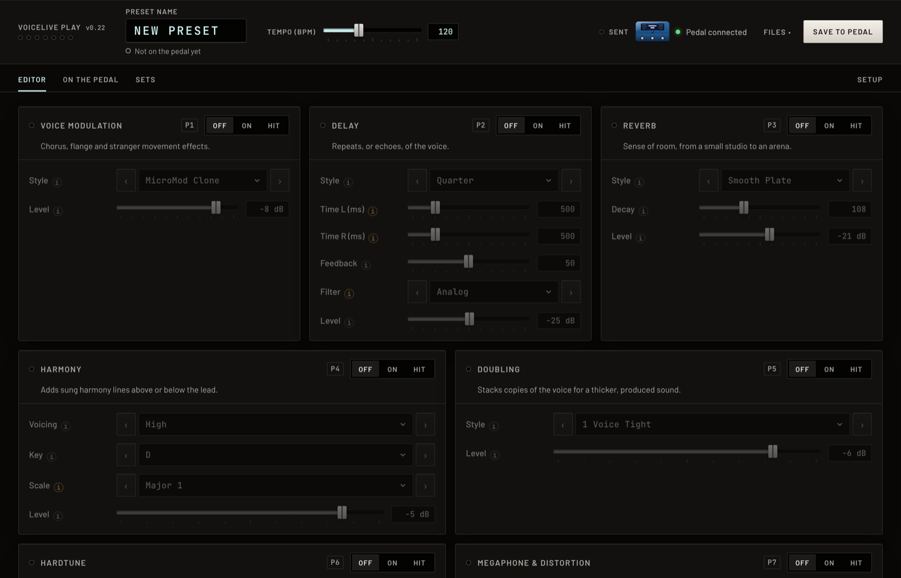

# VoiceLive Play Editor

A full editor for the TC-Helicon VoiceLive Play vocal effects pedal: shape presets on a big screen, see everything
stored on the pedal, build set lists for a gig, and change the pedal's setup menu without digging through the
pedal's small screen.



## Why it exists

The VoiceLive Play is a good-sounding pedal with a small screen, and building a preset on the unit means stepping
through its values one page at a time. When this project started I couldn't find an open-source editor for it, and
TC-Helicon doesn't document how the pedal talks over USB. So I captured that
conversation, decoded it, and built the editor on top of it. The protocol notes are in [PROTOCOL.md](PROTOCOL.md).

It was built for a working singer and tested on her pedal throughout.

## What it does

- **Editor:** every effect block on one screen. Changes play on the pedal instantly; nothing is stored until you save.
- **On the pedal:** reads all 500 slots and lists what's on the unit. Open any preset to tweak it, or duplicate it
  into the first free slot so the original stays safe.
- **Sets:** build a set list song by song, then load it onto the pedal in order.
- **Setup:** the pedal's whole setup menu (inputs, outputs, tuner, foot switches) on one page. "Set up my rig" asks a
  few questions about your mic and cables, shows what it would change and why, and changes nothing until you apply.
- **Plain-language help:** an *i* next to each setting explains what it does and what to pick.
- **Safety:** before any preset is overwritten, a copy is saved to a local backups folder.

## How it's built

There are two versions that share the same protocol code.

- **Desktop:** a small Python server (`server.py`) talks to the pedal over USB MIDI with `python-rtmidi`, and the
  interface runs in your browser at `localhost`. `tch.py` reads and writes the pedal's preset format.
- **Browser:** the same interface talking to the pedal directly through Web MIDI (`web/src/midi.js`), no install.
  It's served by a Cloudflare Worker, which also runs **Community**, a shared preset library on D1. Sign-in is
  Cloudflare Access; the Worker verifies the signed token itself, never trusts a plain email header, and refuses
  exact copies of TC-Helicon's own presets by fingerprint (only hashes are stored, never TC's presets).

## Tests

123 automated tests. All but two run without the pedal:

- **Python (81):** `./run_tests.sh`. They run against `tests/fake_pedal.py`, a simulated VoiceLive Play that answers
  the same SysEx as the real unit, including its quirks. Two read-only hardware checks run only with `VLP_HARDWARE=1`.
- **Browser (42):** `node --test "web/test/*.test.mjs"`.
- Preset encoding is tested against real `.syx` exports from the pedal (`tests/fixtures/`).

## Run it

Built and tested on macOS. Needs Python 3 and a VoiceLive Play connected by USB. Quit VoiceSupport first; only one app can talk to the
pedal at a time.

```bash
python3 -m pip install python-rtmidi
python3 server.py
```

Then open http://localhost:8730. On a Mac you can instead double-click `Start Editor.command`, which sets everything up the first time and opens the editor.

The browser version needs Chrome, Edge or Firefox on a computer. Safari doesn't support Web MIDI.

## Not affiliated

This is an independent project. It is not made, endorsed or supported by TC-Helicon or Music Tribe. VoiceLive and
TC-Helicon are their trademarks. Use it at your own risk: it writes to your pedal, which is why it backs up first.
